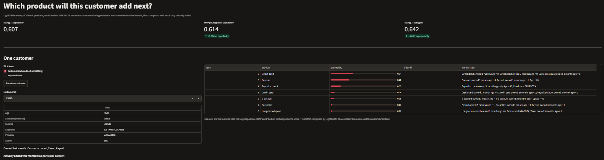

# Next-Product Recommender for Bank Customers

[](https://github.com/Mahendr99ar/product-recommender/actions/workflows/ci.yml)


[](https://product-recommender-mahendra.streamlit.app)

Author: [Mahendra Meena](https://github.com/Mahendr99ar)

Live app: https://product-recommender-mahendra.streamlit.app

A bank has 24 products (current account, credit card, payroll, pension plan, ...) and close to
a million customers. Each month only a few percent of them take a new product. The question is
which product to offer to whom: a list that is the same for everyone wastes most of its slots,
and recommending something the customer already owns wastes all of them.

I built a recommender on the data from Kaggle's
[Santander Product Recommendation](https://www.kaggle.com/c/santander-product-recommendation)
competition: 17 monthly snapshots (January 2015 to May 2016) of customer attributes and product
ownership. For every customer it ranks the products they do not own yet, explains each
recommendation with SHAP values, and is evaluated the way the competition was: MAP@7 on the
products customers actually added in a month the model never saw.

```
 monthly snapshots (customer x month: age, income, segment, ... + 24 products owned 0/1)
        │
        ├──► labels: product added in month m = owned in m and not owned in m-1
        │
        └──► features for month m (only months before m):
               customer attributes · ownership 1..5 months ago · adds and drops per product
                                         │
                                         ▼
              one training row per (customer, month, added product), class = product
                                         │
                                         ▼
                       ┌─────────────────────────────────┐
                       │ LightGBM multiclass, 24 classes │──► TreeSHAP: why this product
                       └─────────────────────────────────┘
                                         │ 24 probabilities
                                         ▼
                remove products owned last month ──► top 7 ──► MAP@7 vs popularity baselines
```



The app on synthetic data. For customer 15019 (46 years old, owns a current account, taxes and
payroll) the model ranks direct debit, pensions and a payroll account highest; the main reasons
come from SHAP, for example pensions because the customer already has payroll. This customer
actually added a Mas particular account, which is not in the top 7: about 12 % of added products
are missed this way (recall@7 = 0.883).

## Features

| Area | What I implemented |
|------|--------------------|
| Data | Chunked conversion of the 2.1 GB Kaggle CSV into one parquet folder per month; cleaning of padded numbers, `-999999` codes, mixed `"1"` / `"1.0"` categories, missing products |
| Labels | Added product = owned this month, not owned last month; new customers count as owning nothing before |
| Features | 190: customer attributes, ownership of each product 1 to 5 months ago, adds and drops per product in the last 5 months, totals, income-missing flag |
| Model | LightGBM multiclass over 24 products, one row per added product; trees chosen by early stopping on the last training month, then refit |
| Baselines | Global popularity, and popularity per segment and age band |
| Evaluation | MAP@7, precision@1, recall@7, Kaggle-style MAP over all customers, recall per product, new vs established customers |
| Statistics | Paired bootstrap 95 % interval for every MAP difference, so a gain is only claimed when the interval excludes zero |
| Re-activations | Additions split into products owned 2 to 6 months earlier and first-time products, scored separately |
| Experiments | Same model, different training months: last month, same month last year, both, last 6 months |
| Explanations | Per-customer SHAP contributions from LightGBM's built-in TreeSHAP, shown in the app as plain-language reasons |
| Synthetic data | Generator with the same columns the model uses and planted behaviour, for tests, CI and the hosted app |
| CI | GitHub Actions runs 12 tests and the full demo pipeline on every push |

## Results

### Kaggle data

13,647,309 rows, 17 monthly snapshots. Trained on the six default months (252,980 training
rows, 190 features, 145 trees, about 3 minutes on a 2-core machine, 3.3 GB peak memory).
Evaluated on May 2016, which the model never saw: 29,717 of 931,453 customers (3.19 %)
added at least one product.

| Model | MAP@7 (customers who added) | Precision@1 | Kaggle-style MAP@7 (all customers) |
|-------|------------------------------|-------------|-------------------------------------|
| Popularity | 0.634 | 0.417 | 0.0202 |
| Segment popularity | 0.652 | 0.456 | 0.0208 |
| **LightGBM** | **0.889** | **0.824** | **0.0284** |

| Comparison | MAP@7 difference | 95 % bootstrap interval |
|------------|------------------|-------------------------|
| LightGBM − popularity | +0.256 | [+0.252, +0.259] |
| LightGBM − segment popularity | +0.238 | [+0.234, +0.241] |

For scale: a perfect Kaggle-style score in this month is 0.0319 (the share of customers who
added something), and the
[2nd-place solution](https://ttvand.github.io/Second-place-in-the-Santander-product-Recommendation-Kaggle-competition)
reached about 0.031 on the June 2016 private leaderboard with a much larger pipeline.

**Half of the "new" products are not new.** The most important feature was `nom_pens_drops`,
the number of times the pensions product was switched off in the last 5 months. That led me
to check: of the 37,897 products added in May 2016, 19,555 (51.6 %) had been owned by the
same customer 2 to 6 months earlier. For credit cards it was 70 %, for payroll and direct
debit 63 %. Products switching off and on again are easy to predict, so I scored the two
kinds separately:

| Model | Re-activations: top-1 | Re-activations: MRR | First-time products: top-1 | First-time products: MRR |
|-------|-----------------------|---------------------|----------------------------|--------------------------|
| Popularity | 40.5 % | 0.621 | 24.5 % | 0.496 |
| Segment popularity | 44.6 % | 0.649 | 26.3 % | 0.502 |
| **LightGBM** | **75.6 %** | **0.870** | **52.8 %** | **0.690** |

On products the customer had never owned in the window, LightGBM still puts the right one
first 52.8 % of the time, against 24.5 % for popularity. So the model is not only learning
"what was switched off comes back".

**Which training months?** Same model, evaluated on May 2016:

| Training months | Rows | Train time | LightGBM MAP@7 |
|-----------------|------|------------|----------------|
| Six default months (incl. June 2015) | 252,980 | 183 s | 0.889 |
| Last month only (April 2016) | 35,229 | 16 s | 0.895 |
| Same month last year (May 2015) | 30,417 | 17 s | 0.880 |
| Same month last year + last month | 65,646 | 30 s | **0.897** |
| Last six months | 251,532 | 160 s | 0.892 |

One recent month trains 11 times faster than six months and scores as well. The most recent
month carries the most information about next month; May 2015 alone is the weakest choice.
The differences between rows are about 0.01 MAP; I have not yet run a paired bootstrap
between experiments, so I treat the ranking of the top three as unconfirmed.

### Sanity check on synthetic data

Before using the Kaggle data I ran everything on synthetic customers with planted behaviour
(a payroll account makes payroll and pension deposits likely next, richer and older customers
add investment products, the tax product spikes in June). 20,000 customers; evaluation month
May 2016; 1,031 customers (5.2 %) added at least one product.

| Model | MAP@7 | Precision@1 | Recall@7 | Kaggle-style MAP@7 |
|-------|-------|-------------|----------|--------------------|
| Popularity | 0.607 | 0.477 | 0.894 | 0.031 |
| Segment popularity | 0.614 | 0.477 | 0.899 | 0.032 |
| **LightGBM** | **0.643** | **0.534** | 0.883 | **0.033** |

| Comparison | MAP@7 difference | 95 % bootstrap interval |
|------------|------------------|-------------------------|
| LightGBM − popularity | +0.035 | [+0.021, +0.049] |
| LightGBM − segment popularity | +0.029 | [+0.015, +0.043] |

The gain comes almost entirely from established customers:

| Customers | Count | Popularity | LightGBM |
|-----------|-------|------------|----------|
| New (less than 6 months) | 302 | 0.912 | 0.911 |
| Established | 729 | 0.481 | **0.531** |

New customers almost all start with a current account, so the most popular product is already
the right answer. For established customers the model can use what they owned before, which a
popularity list cannot.

**Which training months?** All five training-month choices beat popularity, with bootstrap
intervals above zero. Between themselves they differ by about 0.015 MAP, smaller than the width
of their intervals, so on this data I cannot say one is better. On the Kaggle data the question
matters more: June behaves differently from other months (the tax product), and the 2nd-place
writeup found June 2015 to be the most useful month for predicting June 2016.

### Does the evaluation leak?

A recommender that sees the month it predicts looks excellent and is useless. To check, the test
`test_features_never_use_the_target_month_or_later` flips every product in the evaluation month
and all later months and asserts that the features do not change at all; then it flips the month
before and asserts that they do. A second test checks that the SHAP contributions of each product
add up to the model's raw score for that product, so the explanations shown in the app are the
model's actual reasons.

## How to run

**Live app**
Open https://product-recommender-mahendra.streamlit.app, press **Random customer**, and compare
the top 7 with what the customer actually added. The hosted app uses synthetic customers only.

**Local demo** (synthetic data, about 20 seconds)
```bash
python -m venv .venv
.venv\Scripts\activate              # Linux / macOS: source .venv/bin/activate
pip install -r requirements.txt
pip install -e .
python -m prodrec.cli all --demo
pytest
streamlit run app/streamlit_app.py
```

**Kaggle data**
1. Sign in to Kaggle, open the competition page, accept the rules on the **Rules** tab.
2. On the **Data** tab download `train_ver2.csv.zip` and put it in `data/raw/` (no need to unzip;
   pandas reads the zip directly), or use `kagglehub.competition_download("santander-product-recommendation")`.
3. Run:
```bash
python -m prodrec.cli prepare        # CSV -> monthly parquet, about 5 minutes
python -m prodrec.cli train
python -m prodrec.cli evaluate       # writes reports/real/report.md
python -m prodrec.cli experiments    # training-month comparison
```
The full run (prepare, train, evaluate) peaked at 3.3 GB of memory.

## Project structure

```
product-recommender/
├── configs/config.yaml          months, features, model and experiment settings
├── src/prodrec/
│   ├── schema.py                24 products and customer columns, Spanish names → English
│   ├── data/kaggle.py           chunked CSV conversion and cleaning
│   ├── data/store.py            one parquet folder per month, light product-only reads
│   ├── data/synthetic.py        synthetic customers with planted behaviour
│   ├── labels.py                added products per customer and month
│   ├── features.py              190 features, only from earlier months
│   ├── models.py                popularity baselines, LightGBM multiclass, TreeSHAP
│   ├── metrics.py               AP@k, MAP@k, recall per product, paired bootstrap
│   ├── pipeline.py, cli.py      prepare → train → evaluate → experiments
├── app/streamlit_app.py         customer view with reasons, model comparison
├── tests/                       metrics, leakage, CSV cleaning, train/evaluate/explain
├── data/processed/demo/         synthetic months (committed for the hosted app)
├── models/demo/, reports/demo/  demo model and report (committed for the hosted app)
└── .github/workflows/ci.yml     tests + demo pipeline on every push
```

## Design notes

- **One multiclass model, not 24 binary ones.** Each training row is one product a customer
  added, labelled with that product. The model learns a distribution over what gets added, which
  is exactly what the ranking needs, and training only uses the few percent of customers who
  added something.
- **Owned products are removed before ranking.** The model may give a high probability to a
  current account the customer already has; that slot would be wasted, so owned products go to
  the bottom.
- **The evaluation month is never used for training or tuning.** The number of trees is picked
  by early stopping on the last training month; the model is then refit on all training months.
- **Fixed category lists.** Province, channel and the other text columns get their category list
  from the training data, so the same value always gets the same code at prediction time.
- **Memory.** Lag features need only the 24 product columns of earlier months, so those months
  are read without the customer columns, and text columns are stored as categories.
- **The Kaggle data is not in this repository.** I do not re-publish competition data; anyone can
  download it from Kaggle after accepting the competition rules. The repository and the hosted app
  use synthetic customers, and the real data stays on my machine.

## Limitations and next steps

- Half of all additions are re-activations, mostly payroll, pensions and direct debit switching
  off and on with salary payments. A bank would not want to "recommend" those; a production
  version should rank first-time products separately.
- The synthetic data in the hosted app has behaviour I planted, so the app shows how the model
  works, not real customers.
- June 2016, the month the competition asked for, has no public answers, so offline evaluation
  uses May 2016. The June effect can only be tested by predicting June 2015 from earlier months.
- Age and sex are model inputs. A real bank would have to check that recommendations do not treat
  customers unfairly by age or sex before using a model like this.
- Next: months-since-last-added and 12-month lag features (both used by top Kaggle teams),
  probability calibration, and a comparison with 24 binary models.
